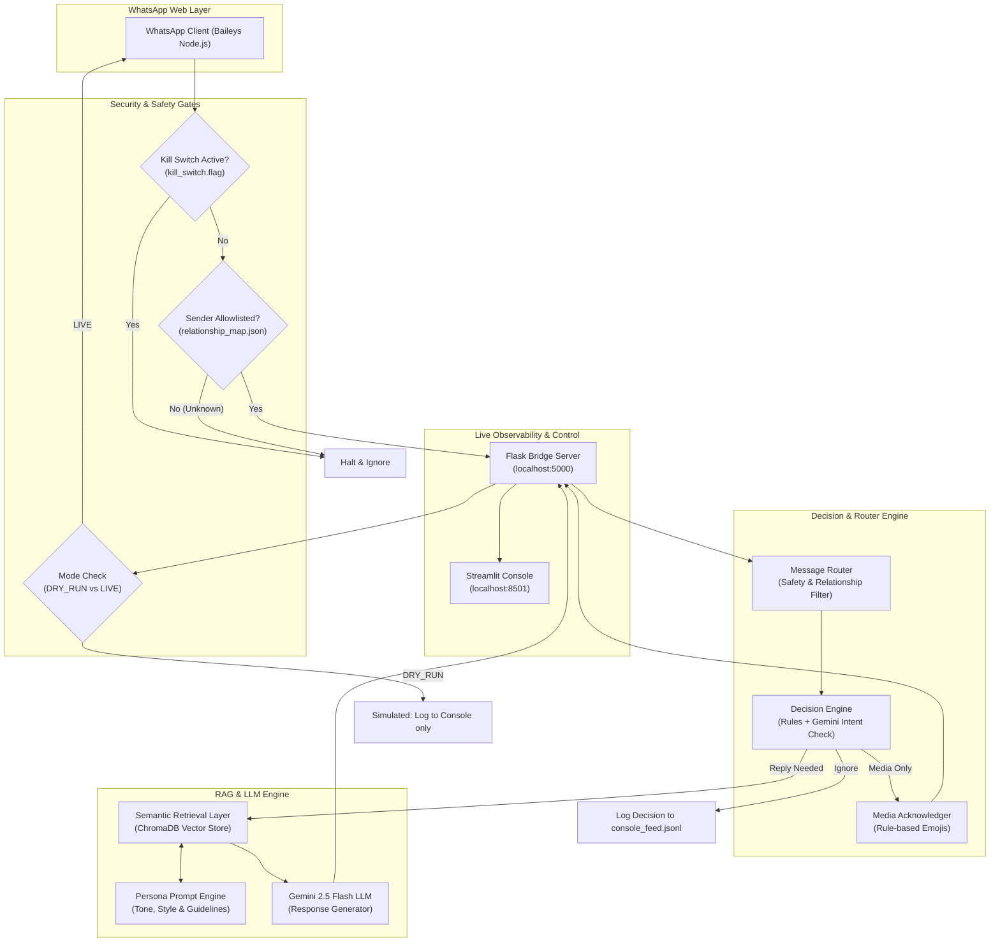

# WhatsApp Cruise Control ⚡

WhatsApp Cruise Control is a course prototype for people who want help handling routine one-to-one messages when they are busy. It decides whether to reply, acknowledge media, or stay silent. When a text reply is appropriate, it retrieves relevant examples from chat history to inform the draft's tone.

**My role:** I built the message decision flow, retrieval and reply generation, and the console for reviewing decisions and controlling the prototype. See the [course project brief](problem_context.md) for the original scope.

## Product decisions

| Decision | Why it matters |
|---|---|
| Decide whether to reply before generating a draft | Rules handle clear cases such as unknown senders and short acknowledgments. A model checks intent for messages that need more judgment. |
| Retrieve examples by relationship | A reply to a friend may call for a different tone than a reply to a colleague. Relevant examples guide the draft. |
| Give the operator a simulation mode and a stop control | The console lets the operator review proposed replies and reasons in simulation. The kill switch pauses automated processing. |

## Example review in simulation

These examples use fictional messages and illustrate the intended behavior.

| Incoming message | What the operator should see |
|---|---|
| “Thanks!” from an approved test contact | The message is skipped as a short acknowledgment. |
| “Can you send me the notes later?” from an approved test contact | If the intent check clears it, the console shows a proposed reply and any retrieved examples. Simulation sends no message. |
| “Can you transfer me some money?” from an approved test contact | The intent check is designed to leave money requests for human judgment. |

The [decision engine tests](agent/test_decision_engine.py) cover decision rules. The [bridge tests](agent/test_bridge.py) cover integration with the message processing service. A next validation step would be to compare decisions against consented or synthetic examples and review inappropriate replies, missed replies, and tone mismatches.

## Consent and data handling

Use synthetic chat exports for a public demo. Obtain explicit consent before using real conversations as examples or involving a contact in a test. The contact allowlist limits who can receive automated replies. Chat exports, the retrieval index, and local logs can contain private information. Keep them out of shared demos. The model provider processes the content supplied for intent classification and reply generation.

---

## 🏛️ System Architecture

The following pipeline illustrates how incoming WhatsApp messages flow through layered safety routers, decision gates, semantic retrieval, and persona generation:



---

## ⚙️ Setup Instructions

Follow these setup steps in order:

### 1. Environment Configuration

Create a `.env` file in the repository root containing your Google Gemini API key:

```env
GEMINI_API_KEY=your_gemini_api_key_here
```

### 2. Python Environment & Dependencies

Set up a Python virtual environment and install all dependencies:

```powershell
# Create Python virtual environment
python -m venv .venv

# Activate the virtual environment (Windows PowerShell)
.\.venv\Scripts\activate

# Install all required Python packages
pip install -r requirements.txt
```

*(Packages include: `chromadb[server]`, `sentence-transformers`, `torch`, `google-genai`, `python-dotenv`, `pytest`, `flask`, `streamlit`, and `streamlit-autorefresh`)*

### 3. Node.js Dependencies

Install the Baileys WhatsApp Web client and its dependencies:

```powershell
npm install
```

*(Packages include: `@whiskeysockets/baileys`, `axios`, `dotenv`, `pino`, and `qrcode-terminal`)*

---

## 🚀 Running the System

Open separate terminal windows and run each service in the following order:

### Terminal 1: ChromaDB Vector Database
Start the persistent Chroma vector store on port 8000:
```powershell
.\.venv\Scripts\chroma.exe run --path ./chroma_data --port 8000
```

The repository contains separate components for [parsing exports](ingestion/parse_export.py) and [building the retrieval index](ingestion/embed_to_chroma.py).

### Terminal 2: Python Flask Bridge Server
Start the HTTP bridge connecting Baileys to the Python decision engine:
```powershell
.\.venv\Scripts\python.exe agent/bridge.py
```
*(Runs on `http://127.0.0.1:5000`)*

### Terminal 3: Streamlit Operations Console
Start the real-time monitoring and control dashboard:
```powershell
.\.venv\Scripts\streamlit.exe run console/app.py
```
*(Opens in your browser at `http://localhost:8501`)*

### Terminal 4: WhatsApp Baileys Client
Start the Baileys WhatsApp client:
```powershell
node whatsapp/baileys_client.js
```
- On first launch, a QR code will print in your terminal.
- **Scan the QR code using a dedicated/secondary WhatsApp number** (via WhatsApp > Linked Devices > Link a Device).
- Once connected, session credentials are saved locally in `./auth_info_baileys/` so you do not need to rescan every time.

---

## 🎛️ How to Use the Operations Console

The Streamlit dashboard (`console/app.py`) provides real-time observability and controls:

1. **Operating Mode (`DRY_RUN` vs `LIVE`):**
   - **`DRY_RUN (Simulation)`**: Incoming messages are evaluated, grounded against ChromaDB, and persona replies are generated and displayed on the console feed, but **never sent over WhatsApp**.
   - **`LIVE (Active Replies)`**: Responses are actively sent back over WhatsApp exclusively to contacts on your allowlist.
   - **Rule:** **Always start every fresh session in `DRY_RUN` mode** to verify decision quality and grounding retrieval traces before going live.

2. **Emergency Kill Switch:**
   - Click the prominent red **🛑 KILL SWITCH** button in the sidebar to halt all processing immediately.
   - Creates a `kill_switch.flag` file in the repo root.
   - A bright red warning banner will stay visible across the top of the dashboard. Both the Baileys client and the Python bridge will refuse to process or send any messages while engaged.
   - Click **Clear Kill Switch** to resume normal operations.

---

> [!CAUTION]
> ### ⚠️ USE RESPONSIBLY
> The checked-in settings enable live mode. Switch the console to `DRY_RUN` before connecting a dedicated test account. Use test contacts who have explicitly agreed to interact with the prototype.
